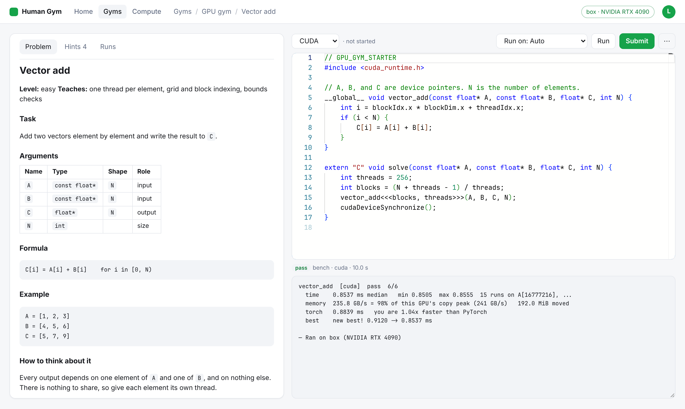

# Human Gym

Practice gyms for engineers who want to get better at GPU kernels, LLM internals, algorithms and ML interviews, with a web board you host yourself.

Each exercise is a function you write and a grader that tests it: correctness first, then speed, measured against your GPU's limits or a time limit. You can practise from the terminal with nothing but this repo, or run a board in the browser for yourself and the people you invite.



## What's inside

| Gym | Exercises | Needs |
| --- | --- | --- |
| [GPU](docs/gpu-gym.md) (`gyms/gpu`) | 29 kernels in CUDA, PyTorch or Triton, from vector add to matmul, flash attention, MoE, sorting and FP16 Tensor Core and int8 kernels, benchmarked against your GPU's memory bandwidth | NVIDIA GPU |
| LLM (`gyms/llm`) | 14 building blocks in PyTorch: RMSNorm, SwiGLU, MoE, LoRA, RoPE, causal, grouped-query and paged attention, KV cache, sampling, beam search, speculative decoding, GRPO loss | NVIDIA GPU |
| Algo (`gyms/algo`) | 19 exercises: intervals, monotonic stacks, binary search on the answer, heaps, tries, LRU, union-find, topological sort, BFS, MST, Dijkstra, DP, in Python (the first nine also in C++), with time limits that reward the right complexity and an editorial for each | CPU |
| [ML coding, ML fundamentals, LLM fundamentals](gyms/README.md) | Interview practice: NumPy coding, plus multiple choice, typed and written answers | CPU |
| [PyTorch and NumPy](gyms/README.md) (`gyms/pytorch-numpy`) | Tensor fluency: views and strides, broadcasting, einsum, gathers and scatters, autograd, training loops, numerics | CPU |
| [ML system design interview](gyms/README.md) (`gyms/ml-system-design`) | The design round: lessons with diagrams on the answer framework, sizing, data and features, retrieval and ranking, experiments, LLM serving (KV cache, batching, cost) and RAG, then worked designs and practice prompts | CPU |
| [GPU and ML systems interview](gyms/README.md) (`gyms/gpu-interview`) | Kernel, performance and ML systems interview prep: lessons, CUDA and Triton fill-ins, rooflines, GPU algorithms simulated in Python, quantization, distributed training, LLM serving, mock deep-dives | CPU |

You can also write your own gym as one Markdown file ([Gym Markdown](gymhub/GYM_MARKDOWN.md)).

## Quickstart

On Linux (x86_64 or aarch64) or an Apple-silicon Mac with Python 3.10+:

```bash
git clone https://github.com/ykirpichev/human-gym && cd human-gym
./setup.sh && source .venv/bin/activate     # venv and PyTorch for this machine

algo-gym next                               # prints the first unsolved exercise and its file
# edit gyms/algo/solutions/<exercise>/solution.py, then:
algo-gym test <exercise>                    # correctness
algo-gym bench <exercise>                   # within the time limit?
algo-gym hint <exercise>                    # stuck? one hint at a time
```

`llm-gym` and `gpu-gym` work the same way. Your solutions and `progress.json` stay local and are gitignored.

**In the browser, on your own GPU.** Run the board on your machine, with no cloud account:

```bash
gymhub-board          # open http://localhost:8080; your runs are graded on this machine's GPU
```

It first prints what this machine can grade (the GPU, whether PyTorch can use it, the CUDA toolkit and Triton) with the fix for anything missing, then starts the board and a runner together; Ctrl+C stops both. Your work is kept in `.cache/gymhub/dev.db` and your solution files. There is no sign-in, so it listens on localhost only; to share it with a group on your network or Tailscale, `gymhub-board --lan` adds name-and-password sign-in ([docs](docs/self-hosting.md#host-it-for-a-group-without-google)). No GPU is needed to start: every gym and course is listed, and a gym that needs hardware this machine lacks says so on its page.

## Documentation

| If you want to | Read |
| --- | --- |
| Practise GPU kernels: the practice loop, reading a benchmark, adding an exercise | [docs/gpu-gym.md](docs/gpu-gym.md) |
| Use the board: Run vs Submit, custom cases, sharing and uploading gyms, the AI tutor, leaderboards | [docs/board.md](docs/board.md) |
| Write a gym or a course | [Gym Markdown](gymhub/GYM_MARKDOWN.md), [gyms/README.md](gyms/README.md) |
| Host the board for other people: on your network with `gymhub-board --lan`, Google Cloud deploy, sign-in, adding machines, grading on the pool | [docs/self-hosting.md](docs/self-hosting.md) |
| Run containers and multi-machine jobs on machines you own | [docs/pool.md](docs/pool.md) |
| Find your way around the code | [CLAUDE.md](CLAUDE.md) |

## How it fits together

- **Graders** (`gpu_gym/`, `gymkit/`) test and time solutions. They are the `gpu-gym`, `llm-gym` and `algo-gym` commands.
- **The board** (`gymhub/`) is a web app with an editor, progress, spaced review and leaderboards. It never runs code: it queues jobs, and machines you add grade them. Your own jobs can run on your machine; other people's are graded in sandboxed containers on the compute pool.
- **The compute pool** (`pool/`) runs containers on machines you register, with no network and every capability dropped. It also runs bigger jobs, such as multi-machine training over a LAN.

## Contributing and security

See [CONTRIBUTING.md](CONTRIBUTING.md) to set up a development environment and run the tests, and [SECURITY.md](SECURITY.md) to report a vulnerability.

## License

[MIT](LICENSE)
